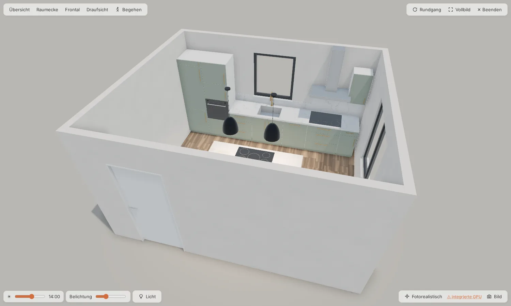
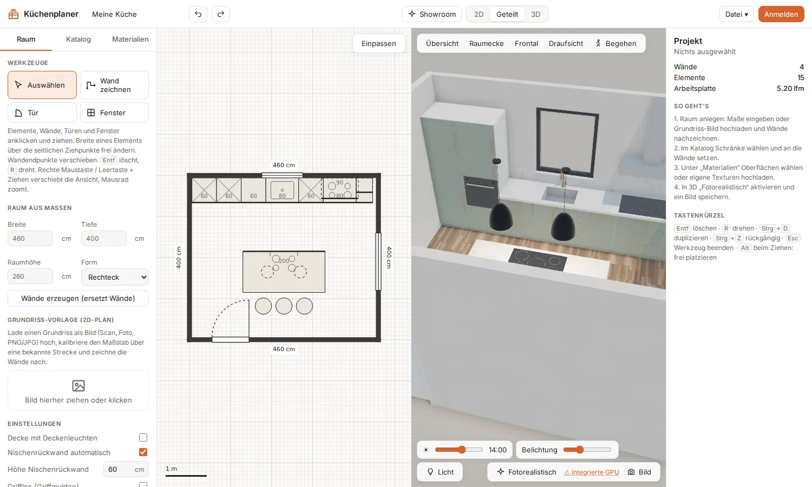
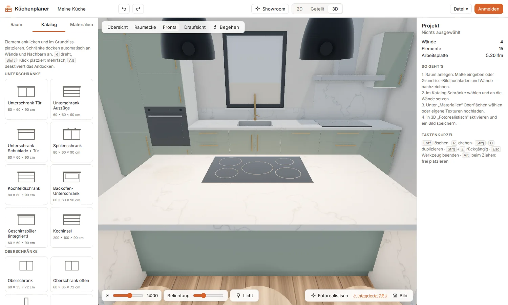
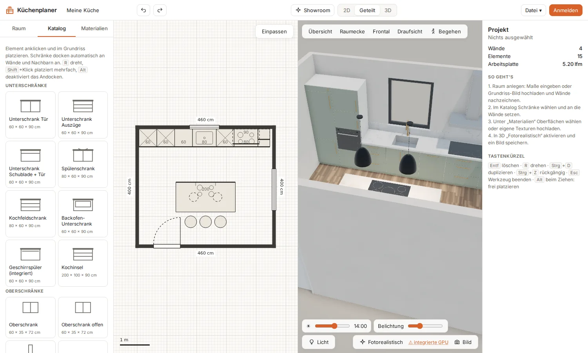
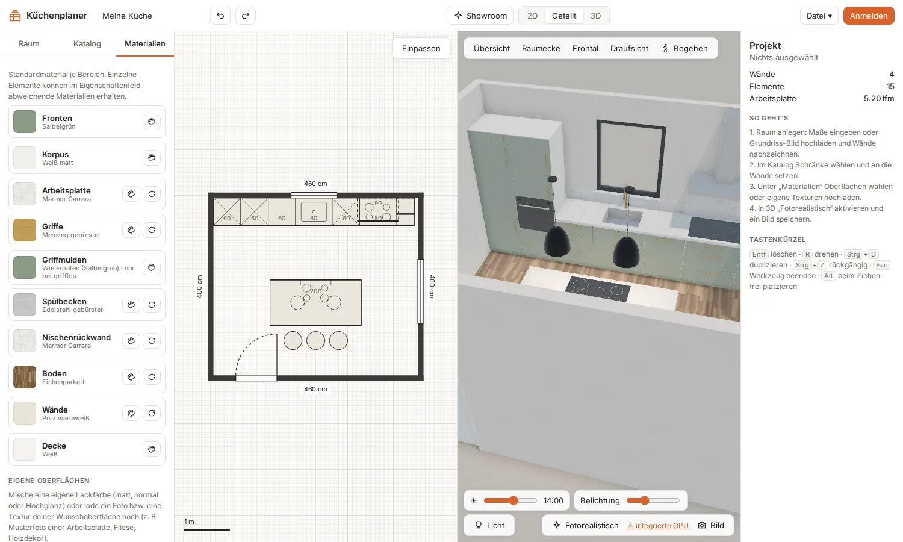
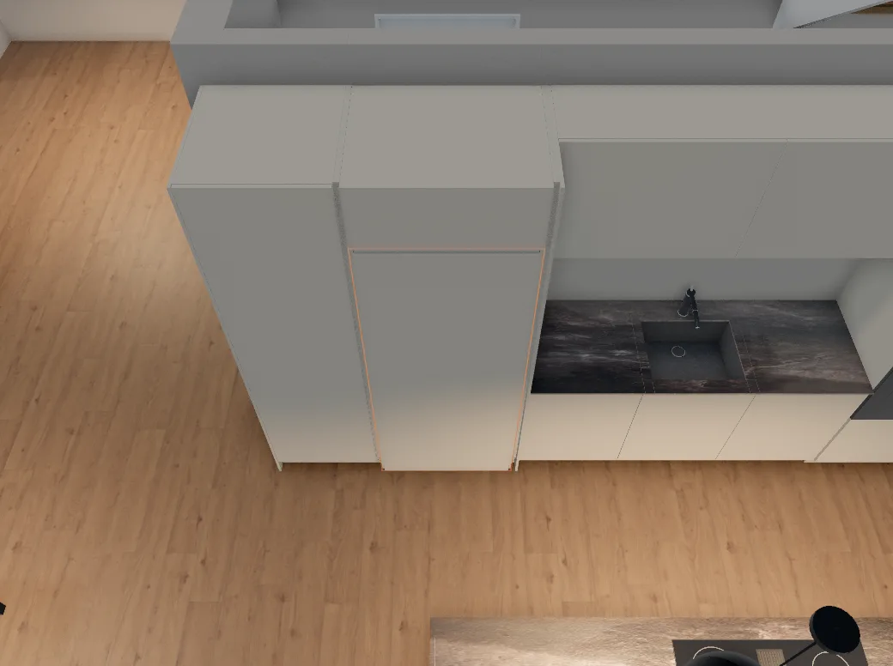

<div align="center">

# 🍳 Kitchen Planner 3D

**From floor plan to photorealistic kitchen – right in your browser.**

Draw a 2D floor plan, snap in cabinets, pick surfaces and view the kitchen in real-time 3D or with path tracing.
Self-hosted, with user accounts and shareable showroom links.

[](https://nodejs.org)
[](#with-docker-recommended)
[](LICENSE)
[](https://kuechenplaner.miefda.org/)
[](https://mupf-dev.github.io/kitchen-planner-3d/)

**[▶ Try the live demo](https://kuechenplaner.miefda.org/)**

[Features](#features) · [A real kitchen](#a-real-kitchen) · [Installation](#installation) · [Guide](#guide) · [Operation](#operation) · [Development](#development)



</div>

> [!NOTE]
> The kitchen planner lives on as the house planner in **[Zuhause](https://github.com/mupf-dev/Homemgmt)** – there it
> covers the whole house and comes with inventory management, where every cabinet compartment is a storage location.
> This repository contains the standalone kitchen planner (version 1.0.0).

> [!NOTE]
> The user interface is available in **English and German**. It follows your browser language; switch it any time with
> the **EN/DE** selector in the header or the URL parameter `?lang=en` / `?lang=de`.

## Features

<table>
<tr>
<td width="50%"></td>
<td width="50%"></td>
</tr>
<tr>
<td><b>2D and 3D side by side:</b> every change in the floor plan shows up instantly in the 3D kitchen.</td>
<td><b>Real-time 3D:</b> shadows, ambient occlusion, time of day and lighting – or photorealistic via path tracing.</td>
</tr>
<tr>
<td></td>
<td></td>
</tr>
<tr>
<td><b>Catalog:</b> base, wall and tall cabinets, appliances, cooking island – they snap to walls and neighbours.</td>
<td><b>Materials:</b> chosen per area, with custom colours, textures and online libraries.</td>
</tr>
</table>

### 📐 Planning

- **Floor plan editor**: walls with length input, angle and endpoint snapping; doors and windows; room from dimensions
  (rectangle, L-shape)
- **Floor plan as template**: upload a scan or photo, calibrate the scale on a known distance, trace it
- **Catalog** with base, wall and tall cabinets, appliances, cooking island, side panels and vertical grip profiles;
  width adjustable by drag handle, undo/redo
- **Handleless kitchens** with grip channels (horizontal/vertical), fronts with doors, flaps or 1–4 drawers
- **Cooking island** with custom column widths, back side as breakfast bar or with doors, overhangs and downdraft hob

### 🎨 Materials

- **Library** with lacquers, wood, stone, ceramic, metal, tiles and floors (scans from [Poly Haven](https://polyhaven.com), CC0)
- **Custom surfaces**: lacquer colour via colour wheel (matt, satin, high gloss) or upload a photo/texture (including
  normal and roughness maps)
- **Online libraries** [Poly Haven](https://polyhaven.com) and [ambientCG](https://ambientcg.com), imported to the server
- **Texture alignment** per area and element: stretch or tile, size, rotation, offset
- **Colour adjustment**: hue, saturation, brightness, contrast, recolouring, gloss

### 🖼️ 3D and presentation

- **Real time** with shadows, ambient occlusion, time of day and lighting controls (sun, sky, lamps, softness)
- **Photorealistic**: GPU path tracing that refines continuously; save as PNG
- **Walk-through** with WASD and mouse, camera presets (overview, room corner, front, top)
- **Showroom**: full-window 3D without toolbars, with guided tour and full screen

### 🌐 Languages

- **English and German** user interface, chosen from the browser language, switchable in the header (**EN/DE**) or via
  `?lang=en` / `?lang=de`; server messages are translated too

### 👥 Accounts and sharing

- **Login**; the first account becomes the administrator. Sign-up on/off, approval of new accounts, user management
- **Plans in your account**: save, open, rename, copy, delete
- **Showroom link**: share a plan for viewing without login (read-only, revocable at any time)
- Without logging in the planner still works – plans are then stored in the browser

## A real kitchen

The planning engine of this kitchen planner now powers the house planner in [Zuhause](https://github.com/mupf-dev/Homemgmt).
A real kitchen was planned with it there – handleless tall cabinets with a pass-through door disguised as a cabinet,
stone worktop with undermount sink and a cooking island (images from Zuhause):

<table>
<tr>
<td width="50%"></td>
<td width="50%"></td>
</tr>
<tr>
<td><b>Kitchen:</b> handleless fronts, pass-through to the utility room disguised as a cabinet.</td>
<td><b>In the house:</b> kitchen run and cooking island in the open-plan ground floor.</td>
</tr>
</table>

## Installation

### With Docker (recommended)

```bash
git clone https://github.com/mupf-dev/kitchen-planner-3d.git
cd kitchen-planner-3d
docker compose up -d --build
```

The planner then runs at **http://localhost:3010**. Data is stored in the volume `kuechenplaner-data` (`/data` inside
the container).

### Without Docker

Requires **Node.js ≥ 22.18** (built-in `node:sqlite`; the server runs TypeScript without a build step).

```bash
git clone https://github.com/mupf-dev/kitchen-planner-3d.git
cd kitchen-planner-3d
npm install
npm run build && npm start     # → http://localhost:3001
```

## Guide

1. **Create the room** – in the *Room* tab, enter width, depth and height and click *Create walls*, or draw them
   yourself with *Draw wall*. Alternatively upload a floor plan image, calibrate it with *Scale* and trace it.
2. **Doors and windows** – place them on a wall with the *Door* and *Window* tools.
3. **Place cabinets** – in the *Catalog* tab, click an element and then click into the floor plan. Cabinets snap to
   walls and neighbours; `R` rotates, `Shift`+click places several, `Alt` places freely. Change the width with the drag
   handles on the sides.
4. **Choose surfaces** – in the *Materials* tab, pick a material per area (fronts, carcass, worktop, handles,
   floor …). Individual elements can get different materials in the properties panel on the right.
5. **View** – switch between *2D*, *Split* and *3D* at the top. In 3D, turn on *Photorealistic* and save with
   *Image*, or use *Showroom* for presentations.
6. **Save and share** – *Log in*, save the plan to your account and create a showroom link. Without an account:
   *File → Export as file (.json)*.

**Keyboard shortcuts:** `Del` delete · `R` rotate · `Ctrl`+`D` duplicate · `Ctrl`+`Z` undo · `Esc` exit tool ·
`Alt` while dragging: place freely

> [!TIP]
> Path tracing runs many times faster on a dedicated graphics card. On Windows, go to *Settings → System → Display →
> Graphics* and choose *High performance* for your browser – the planner shows instructions when it only detects the
> integrated GPU.

## Operation

| Variable | Default | Meaning |
|----------|---------|---------|
| `PORT` | `3001` (Docker: `3000`, exposed as `3010`) | HTTP port |
| `DATA_DIR` | `data/` (Docker: `/data`) | Database `kuechenplaner.db` and imported textures |
| `TRUST_PROXY` | – | `1` behind a reverse proxy (real client IP) |
| `COOKIE_SECURE` | – | `1` with HTTPS (secure cookie) |

**Behind a reverse proxy** (Caddy, nginx, Traefik, Zoraxy …) with HTTPS, set `TRUST_PROXY=1` and `COOKIE_SECURE=1`.
You can then attach the container directly to the proxy network without a host port (e.g. via a
`docker-compose.override.yml`).

**Security:** passwords hashed with scrypt and salt; sessions as a random token in an HttpOnly cookie (30 days), stored
in the database only as a SHA-256 hash.

## Development

```bash
npm install
npm run dev      # Vite (http://localhost:5173) and API server (port 3001) together
npm run build    # type check and build into dist/
```

### Translations

The UI is written in German in the source; `src/i18n/index.ts` translates all texts in the DOM (text nodes and
`title`/`placeholder`/`alt`/`aria-label`) as well as native dialogs, using a dictionary keyed by the German text
(`src/i18n/en.ts`). Keys containing `{}` are patterns for texts with variable parts. To add a language, add a
dictionary and register it in `LANGS`/`DICTS`.

### Structure

```
src/plan2d.ts                 2D editor: walls, doors/windows, floor plan template, scale, placement with snapping
src/scene3d.ts                three.js scene: shadows, GTAO, daylight, walk-through, path tracer
src/models.ts                 procedural cabinet and appliance models
src/materials.ts, procedural.ts  material library, procedural textures, custom textures
src/catalog.ts                element catalog
src/state.ts                  project state, undo/redo, autosave, JSON export
src/account.ts                account, saved plans, user management, showroom links
src/i18n/                     translations (index.ts: translation layer, en.ts: English dictionary)
server/index.ts               Express + node:sqlite: login, plans, sharing
server/library.ts             online libraries (Poly Haven, ambientCG), import to the server
site/                         project website (GitHub Pages) and screenshots
```

**Tech stack:** TypeScript, Vite, [three.js](https://threejs.org),
[three-gpu-pathtracer](https://github.com/gkjohnson/three-gpu-pathtracer), Express 5, built-in `node:sqlite`.

## License

[GNU Affero General Public License v3.0](LICENSE). You may use, modify and redistribute the kitchen planner. Anyone who
distributes a modified version or offers it as an online service must publish the source code under the same license.

Floor textures from [Poly Haven](https://polyhaven.com) (CC0), see [public/textures/LICENSE.txt](public/textures/LICENSE.txt).
